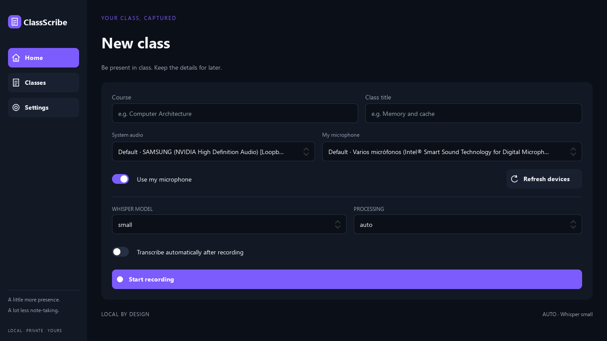

# ClassScribe

ClassScribe records university classes locally or imports lecture audio from YouTube,
and transcribes them **after capture or import completes**.
Windows WASAPI loopback captures what you hear from Google Meet, Teams, Zoom, a browser,
or another desktop application. An optional microphone is recorded as a separate track.
Alternatively, paste a YouTube video URL to inspect metadata, download audio only, store
it locally as a session source (`system.wav`), and send it through the **same** ClassScribe
transcription pipeline. It has no dependency on the meeting platform or its APIs.

This is an independent Python 3.12 project. It does not copy the old transcription engine
from `Youtube_Transcrip` or build a second Whisper integration; YouTube sessions reuse the
modern ClassScribe overlapping-window transcription pipeline, session library, and viewer.
Use the native Qt Quick desktop interface or the fully supported CLI. There is no cloud
service, live transcription, remote speaker diarization, or AI study feature.

## Desktop application

```powershell
pip install -e ".[audio,transcription,cuda,gui,youtube]"
classscribe-gui
# Alternative:
python -m classscribe.gui
```

The optional `gui` extra adds PySide6; `youtube` adds `yt-dlp[default]` and PyAV for
YouTube audio import; `cuda` adds the Python-packaged CUDA 12 cuBLAS and cuDNN 9 runtime
libraries (`nvidia-cublas-cu12` and `nvidia-cudnn-cu12`) on both Windows and Linux.
Headless installations do not require Qt. For CPU-only use, omit `cuda` and select CPU
in the application.

On **Home**, enter a course and title, check the readable system/microphone selectors,
and click **Start recording**. Disable the microphone if you only need class audio.
Refresh devices after plugging in a headset. The default selection follows the current
Windows default; recording uses the devices selected at start.
You can also paste a **YouTube video URL** on Home, click **Inspect video** to preview the
title, channel, and duration (automatically filling blank title/course fields), and click
**Import YouTube audio** to download audio into a local session (`system.wav`) and optionally
auto-transcribe it. Importing immediately after inspecting the same video reuses the
inspected metadata without a duplicate lookup; changing the URL inspects the new video.

The recording screen displays elapsed time and separate audio meters. **Stop recording**
finishes the audio files before offering transcription. Enable automatic transcription
on Home to start Whisper after that finalization. Closing during recording asks whether
to stop and save first; it never kills the recording worker.

**Classes** lists sessions newest first, showing whether each session came from a local
recording or a YouTube import. Open a class to inspect all transcription runs
or transcribe again with another model/device. Each run is preserved. The built-in viewer
reads structured JSON, distinguishing **CLASS** (system audio), **ME** (microphone), and
**VIDEO** (imported YouTube media).
You can also open the Markdown transcript or its folder in your default applications.

**Settings** provides dark/light/system themes, devices, model, processing device, language,
offline mode and storage directories. Click **Save settings** to persist your choices.
Diagnostics is manual; model loading/inference requires explicitly enabling its checkbox.
There is no inference cancellation: closing can wait for completion.

Desktop storage defaults to `Documents/ClassScribe/{recordings,transcripts,models}`;
preferences use Qt's per-user application configuration directory. CLI TOML settings
remain independent. To see existing CLI sessions, point the GUI's storage settings at
the same absolute directories. Changing storage settings does not move files.

Actual offscreen screenshot of the implementation at 1366×768, with device discovery
and no active recording:



See [desktop architecture, validation and limitations](docs/GUI.md) and
[Windows bundle instructions](docs/GUI_DEPLOYMENT.md).
The [implementation report](docs/GUI_IMPLEMENTATION_REPORT.md) records changed files,
tests actually run and remaining manual acceptance work.

## Workflow and architecture

```text
Meeting / Windows playback ─> WASAPI loopback ─> bounded queue ─> system WAV parts
Selected microphone       ─> WASAPI input    ─> bounded queue ─> microphone WAV parts
YouTube video URL         ─> yt-dlp audio    ─> PyAV PCM16    ─> system WAV parts
                              common monotonic recording timeline
                                         |
                              stop/import, drain, finalize audio
                                         |
                              load faster-whisper model
                                         |
                              CPU / NVIDIA CUDA inference
                                         |
                              partial JSONL ─> final JSON + Markdown
```

Whisper and CTranslate2 are lazily imported. `record --transcribe` and `youtube --transcribe`
finalize all WAV files and persist `recorded` before importing the transcription service.
No model runs during capture or download.

| Component | Responsibility |
| --- | --- |
| `classscribe/audio/devices.py` | Device mapping, IDs, exact-name/default selection |
| `classscribe/audio/interfaces.py` | Mockable audio backend and stream contracts |
| `classscribe/audio/wasapi.py` | Isolated PyAudioWPatch adapter and timestamp conversion |
| `classscribe/audio/writer.py` | Bounded queues, PCM16 WAV writing, silence gaps, rotation |
| `classscribe/audio/recorder.py` | Start/stop lifecycle, Ctrl+C, cleanup, metadata checkpoints |
| `classscribe/youtube.py` | YouTube URL validation, `yt-dlp` metadata/audio download, PCM16 WAV storage |
| `classscribe/application/youtube.py` | Shared YouTube inspection and session import service |
| `classscribe/sessions/` | Unique identities, safe directories, status transitions |
| `classscribe/transcription/` | Lazy engine, CUDA, audio windows, runs, structured outputs |
| `classscribe/config.py`, `storage.py` | Validated TOML, atomic JSON, operation locks |
| `classscribe/doctor.py`, `cli/` | Diagnostics and user commands |

The design was informed by inspection of the reference repository's
[runtime setup](https://github.com/luismariofg132/Youtube_Transcrip/blob/main/runtime.py)
and [transcription code](https://github.com/luismariofg132/Youtube_Transcrip/blob/main/transcribe.py).
The new implementation retains lazy model loading, process-local Windows DLL discovery,
explicit device selection, model caching, and partial recovery, while routing YouTube audio
imports through the single ClassScribe session and transcription pipeline.

## Installation

Use 64-bit **Python 3.12** and Windows 10/11 for capture. In a checkout of this project:

```powershell
py -3.12 -m venv .venv
.\.venv\Scripts\python.exe -m pip install --upgrade pip
.\.venv\Scripts\python.exe -m pip install -e ".[audio,youtube,transcription]"
.\.venv\Scripts\python.exe -m classscribe --help
```

If the Python launcher is unavailable, use a Python 3.12 executable or
`uv venv --python 3.12 .venv`, then `uv pip install -e ".[audio,transcription]"`.
Activate `.venv` to use `classscribe` directly, or keep using the explicit Python path.
No system FFmpeg executable is required; faster-whisper uses PyAV.

### CPU installation

The installation above supports CPU transcription. Select `--device cpu`. Linux can
transcribe session directories copied from Windows, but cannot capture audio in this MVP:

```bash
python3.12 -m venv .venv
.venv/bin/python -m pip install -e '.[transcription]'
.venv/bin/python -m classscribe doctor --device cpu --model tiny
```

`small` is the default model. Supported models: `tiny`, `base`, `small`, `medium`, `large-v3`.
Each model downloads from Hugging Face on its first use and is cached under `models/`.
Cached models are preferred without a network lookup. `--offline` prohibits Whisper model
downloads and requires an existing local model cache (missing caches fail with an actionable
error). `--offline` applies only to transcription model acquisition; YouTube metadata
inspection and audio download still require internet access because they contact YouTube.
Model weights are never part of Git.

### NVIDIA CUDA installation

Working CUDA inference requires three distinct layers:

1. **NVIDIA GPU driver**: Install a current NVIDIA driver. Note that the CUDA version shown
   by `nvidia-smi` reflects driver capability, **not** proof that CUDA/cuDNN inference runtime
   libraries are installed or loadable.
2. **Python-installed CUDA 12 cuBLAS and cuDNN 9 runtime libraries**: Current upstream
   `faster-whisper` / `ctranslate2` GPU builds require [CUDA 12 cuBLAS and cuDNN 9](https://github.com/SYSTRAN/faster-whisper#gpu).
   Installing the `cuda` extra installs both `nvidia-cublas-cu12` (`>=12.4,<13`) and
   `nvidia-cudnn-cu12` (`>=9,<10`) on Windows and Linux.
3. **CUDA inference validation**: Verify actual model execution with `classscribe doctor --device cuda --model tiny`.

```powershell
.\.venv\Scripts\python.exe -m pip install -e ".[audio,transcription,cuda,gui,youtube]"
.\.venv\Scripts\python.exe -m classscribe doctor --device cuda --model tiny
```

On Windows, the application automatically discovers DLLs inside installed `ctranslate2` and
`nvidia` (`cublas` and `cudnn`) Python packages, retains `os.add_dll_directory` handles for
the process lifetime, and prepends those directories only to its own process `PATH`. It never
modifies system-wide environment variables, and no external CUDA Toolkit installation is
required for the supported pip-based path. Missing Microsoft runtime DLLs can require the
[Visual C++ Redistributable](https://learn.microsoft.com/en-us/cpp/windows/latest-supported-vc-redist).

On Linux, the `cuda` extra also installs `nvidia-cublas-cu12` and `nvidia-cudnn-cu12`. Set
the library path before starting Python:

```bash
.venv/bin/python -m pip install -e '.[transcription,cuda]'
export LD_LIBRARY_PATH="$(.venv/bin/python -c 'import nvidia.cublas, nvidia.cudnn; print(str(nvidia.cublas.__path__[0]) + "/lib:" + str(nvidia.cudnn.__path__[0]) + "/lib")')${LD_LIBRARY_PATH:+:$LD_LIBRARY_PATH}"
.venv/bin/python -m classscribe doctor --device cuda --model tiny
```

CUDA prefers `int8_float16` when CTranslate2 reports support; other supported GPU compute
types are considered on the same GPU. CPU prefers `int8`. See
[CTranslate2 compute types](https://opennmt.net/CTranslate2/quantization.html).
Inference is unbatched with one model shared sequentially by both tracks. Start with `small`
or `tiny` on limited VRAM. `auto` chooses CUDA if CTranslate2 detects a GPU, otherwise CPU.
If the selected CUDA runtime fails, **the job fails; it never silently retries on CPU**.

## Commands

Examples assume an activated environment; `python -m classscribe` is interchangeable
with `classscribe`.

### Diagnostics and devices

```powershell
classscribe doctor
classscribe doctor --json
classscribe doctor --device cuda --model tiny
classscribe doctor --device cpu --model tiny --offline
classscribe devices
```

Plain `doctor` reports Python, OS, package status, default output/microphone, GPU name,
VRAM/driver information, and CTranslate2 import/device detection. It does not load a model.
Passing `--device` explicitly performs synthetic one-second inference with VAD disabled
and consumes the segment generator. Only this test may report CUDA inference as passed.
It can download the chosen model unless `--offline` is set. A diagnostic never records
the microphone. A nonzero exit code means a required check failed; hardware visibility
alone never proves inference works.

Device listing shows WASAPI **loopback** IDs for system audio and WASAPI input IDs for
microphones. Defaults are marked. IDs are PortAudio indices, not separate consecutive
lists starting at zero; they can change after reconnecting hardware. Selection accepts
an exact name (case-insensitive) or an ID; ambiguous/missing selections fail clearly.
[PyAudioWPatch](https://github.com/s0d3s/PyAudioWPatch) exposes output loopbacks as input
devices. Stereo Mix, virtual cables, extensions, and meeting APIs are unnecessary.

### Recording

```powershell
classscribe record --title "Memoria Cache" --course "Arquitectura de Computadores"
classscribe record --title "Clase" --no-microphone
classscribe record --title "Clase" --output-device 10 --microphone-device 4
classscribe record --title "Prueba" --no-microphone --duration 15
```

Replace `10` and `4` with your actual IDs. Press **Ctrl+C once** to stop and finalize.
A single-line elapsed timer appears in an interactive terminal. Redirected output is
quiet during capture. Microphone capture is enabled by default; use `--no-microphone`
if none is available. `--microphone` overrides a disabled config default; supplying
`--microphone-device` also enables it unless contradictory `--no-microphone` is supplied.

### YouTube import

```powershell
classscribe youtube "https://www.youtube.com/watch?v=VIDEO_ID" --inspect
classscribe youtube "https://www.youtube.com/watch?v=VIDEO_ID"
classscribe youtube "https://www.youtube.com/watch?v=VIDEO_ID" --title "Lecture 4" --course "Operating Systems" --transcribe --device cuda
```

`youtube --inspect` contacts YouTube over the network and prints structured JSON metadata
(video ID, canonical URL, title, channel, and duration) without downloading audio. Without
`--inspect`, ClassScribe transitions the new session through `created → importing → recorded`,
downloads the best audio stream via `yt-dlp`, decodes and normalizes it to mono 16 kHz PCM16
WAV (`system.wav`, rotating at 1 GiB if needed) inside the session directory using PyAV, and
deletes the temporary compressed download (`source-*`) once the durable PCM WAV is finalized.
If download or decoding fails, temporary `source-*` files are cleaned up and the session is
marked `failed` with `recording_finalized = false` (which prevents transcription). Passing
`--transcribe` runs the standard local ClassScribe transcription pipeline immediately after
session audio is finalized. Re-transcribing a YouTube session later
(`classscribe transcribe SESSION_ID`) reuses the local `system.wav` without re-downloading.
`--offline` on `youtube --transcribe` allows the YouTube download over the network while
requiring the Whisper model to be present in the local model cache.

### Transcription and combined workflow

```powershell
classscribe transcribe SESSION_ID --model small --device auto --language es
classscribe transcribe SESSION_ID --model medium --device cpu --offline
classscribe record --title "Clase" --course "Arquitectura" --transcribe --device cuda
```

Use the **full session ID** printed at recording startup or YouTube import, or the exact
session directory name. Lookup uses `recordings/`; override with `--recordings-dir`. Every
transcription creates a fresh run, including retries with the same model. Original audio and
all earlier outputs remain intact. `--language auto` detects language per audio window; detected
languages are recorded per segment and in the final result.

## Configuration

Copy `classscribe.example.toml` to `classscribe.toml`, which is ignored by Git:

```toml
device = "auto"
model = "small"
language = "es"
microphone = true
offline = false
recordings_dir = "recordings"
transcripts_dir = "transcripts"
models_dir = "models"
```

Precedence: built-in defaults, then TOML, then explicit CLI arguments. Relative paths
are relative to the current working directory, including those in TOML. Put `--config`
before the subcommand: `classscribe --config D:\Classes\classscribe.toml record --title "Clase"`.
Use a stable working directory or absolute configured directories to find old sessions.
Unknown keys and invalid settings fail instead of being ignored.

## Local files and schemas

```text
recordings/
  2026-10-15_183000_clase_<unique-suffix>/
    session.json
    system.wav
    system-0002.wav              # only when a WAV part exceeds 1 GiB
    microphone.wav              # optional, independently rotated
transcripts/
  <session-id>/
    small-<unique-run-id>/
      run.json
      segments.partial.jsonl    # durable segment journal, also retained on success
      result/                   # published together only after successful inference
        transcript.json
        transcript.md
models/                         # shared model cache
```

Session directory and ID are never reused; metadata evolves atomically. Session JSON
contains schema/application versions, title/course, UTC start/end times, duration,
platform, device descriptions, audio filenames, sample rates/channel counts and per-track
timing/part metadata. It omits hostnames, account names and machine serial numbers.
States are `created → recording → recorded → transcribing → completed` for live capture
and `created → importing → recorded → transcribing → completed` for YouTube imports.
Errors become `failed`; completed or failed transcription runs can be re-transcribed only
when the session audio was successfully finalized (`recording_finalized = true`). An
exclusive session lock prevents simultaneous transcription operations.

Each final JSON segment has `source`, `start`, `end`, `text`, `language`, `audio_file`,
`audio_start` and `audio_end`. `start/end` use the common session timeline; `audio_start/end`
seek within the named WAV part. Segments from all tracks are sorted chronologically,
preserving overlaps. While imported YouTube audio is stored physically as `system.wav`
(`tracks["system"]`) for pipeline compatibility, its transcript segments carry semantic
`"source": "media"`. In Markdown, `CLASE` denotes system playback, `YO` denotes microphone
audio, and `VIDEO` denotes imported media (`CLASS`, `ME`, and `VIDEO` in the desktop GUI).
None of these labels claims speaker identity, and no speaker diarization is performed.

### Track synchronization and reliability

Each PortAudio ADC timestamp is mapped to `perf_counter()` using the callback's current
PortAudio time; the streams are not assumed to share an epoch or start simultaneously.
The first captured buffer determines each track's `start_offset_seconds`. When ADC timing
is unavailable, callback arrival minus buffer duration is used and explicitly recorded
as `callback_minus_buffer`. Initial offsets are approximate: callback scheduling and driver
timing affect accuracy. Hardware clocks can drift; no sample-rate drift correction is
implemented. Timing discrepancies over 100 ms are not silently ignored: forward gaps
insert silence, backward discontinuities fail capture. Inspect timing metadata when
precise alignment is important.

Recording uses PCM16 at each device's native rate and up to two channels, a 128-buffer
queue per source (1024-frame callbacks), and one disk writer per track. Audio is never
accumulated for the entire class. Every write patches the WAV header; periodic flush/fsync
and atomic metadata checkpoints reduce recoverable loss. WAV rotates at 1 GiB to avoid
RIFF's 4 GiB limit. At 48 kHz stereo, system audio alone takes roughly 0.69 GB/hour.
Ensure adequate disk space and prevent sleep during class. Original audio is never deleted.

Disconnects, PortAudio error flags, queue overflows and disk failures stop capture and
finalize all possible files. A failed capture is not automatically transcribed; preserve
and inspect its audio first. Power loss, force-kill, disk exhaustion and faulty drivers
cannot guarantee complete recovery. Files may need manual WAV/header repair; crash recovery
is not automatic. A stale `.operation.lock` should only be removed after confirming no
ClassScribe process is using that session. Do not mark a damaged recording as finalized
without validating its files and timing metadata.

Transcription uses five-minute windows with 15 seconds of overlap to improve context near
long-audio boundaries while keeping audio memory bounded. Overlap is inference context only:
duplicate overlap output is discarded through timestamp ownership before saving segments.
Final timestamps still refer to the original recording. Overlap stays within each WAV part,
and short recordings use one window. This improves context without guaranteeing perfect
decoding or word-level alignment. See [window ownership](docs/TRANSCRIPTION_WINDOWS.md)
for the exact rule and edge cases. Text segments are held in memory for the final
chronological merge;
the segment journal is flushed and fsynced after each segment. On failure, inspect
`segments.partial.jsonl` and `run.json`; rerunning starts a new run, not an automatic resume.
A final `result/` directory is the publication marker. If a crash happens after publication
but before status metadata updates, the published result is usable; session status may be stale.

## Privacy and responsibility

All recordings and inference stay local. No OpenAI API, API keys, analytics, telemetry,
automatic uploads, or cloud transcription are used. Hugging Face telemetry and implicit
authentication are disabled in the inference process. Internet is needed only for package
installation, explicit YouTube metadata/audio import, and uncached model downloads;
`--offline` requires an existing local model cache for transcription.
Audio files, transcripts, caches, logs and local config are excluded from Git.

You are responsible for ensuring you have permission to record and transcribe the class
or meeting. System loopback captures **all playback on the selected Windows endpoint**,
including notifications and other applications. The app does not isolate Meet audio.
Speaker playback may also enter the microphone acoustically; headphones can reduce this.
Files are ordinary local files, without application-level encryption or automatic retention.

## Troubleshooting and limitations

| Symptom | Action |
| --- | --- |
| Audio backend missing | Install the `audio` extra on Windows and run `devices` |
| No default microphone | Select an available input or use `--no-microphone` |
| Empty or wrong system audio | Select the loopback of the endpoint the meeting uses |
| Device ID stopped working | Re-run `devices`; reconnects can change IDs |
| Unsupported format / Bluetooth change | Use a stable endpoint; test a short recording first |
| Capture stops with overflow | Reduce other disk/CPU load, use local storage, inspect preserved audio |
| Missing CUDA DLL | Install `.[cuda]` (CUDA 12 cuBLAS + cuDNN 9) and MSVC runtime; run the inference doctor |
| CUDA out of memory | Close GPU-heavy apps after class, select `small`/`tiny`, or explicitly choose CPU |
| Offline model missing | Download once without `--offline`, then rerun offline |
| Interrupted transcription | Keep partial JSONL; rerun the session to create a new result |
| Poor recognition | Check source recording quality, language, and try a larger model |

Windows-first capture, all-playback loopback, approximate timing, independent clock drift,
overlapping speech, and recognition errors are MVP limitations. A long silent interval can
depend on endpoint/driver callback behavior. There is no hot device switching, pause/resume,
sample-accurate synchronization, echo cancellation, SRT/VTT export, live transcription,
speaker diarization, automatic meeting joining, or study-generation pipeline.

## Development and validation

```powershell
# Lightweight core environment (no PyAV/yt-dlp or Qt required):
python -m pip install -e ".[dev]"
python -m pytest --ignore=tests/test_youtube.py --ignore=tests/test_gui.py

# YouTube integration tests:
python -m pip install -e ".[dev,youtube]"
python -m pytest tests/test_youtube.py

# Full suite including offscreen GUI:
python -m pip install -e ".[dev,gui,youtube]"
python -m pytest
python -m ruff check .
python -m ruff format --check .
```

Tests use temporary directories, synthetic PCM and fake hardware/inference interfaces.
Network sockets are disabled in the test process. They require no devices, GPU, model
downloads, network, or meeting account. If your sandbox cannot write the default temporary
directory, use `python -m pytest --basetemp .tools/pytest-temp` (this directory is disposable).
GitHub Actions splits validation into three jobs: `core` (`windows-latest` and `ubuntu-latest`
with `.[dev]`), `youtube` (`windows-latest` and `ubuntu-latest` with `.[dev,youtube]`), and
`gui` (`windows-latest` offscreen with `.[dev,gui,youtube]`). CI does **not** validate actual
WASAPI capture or CUDA hardware.

Before relying on a full class, manually test a short recording on your endpoint, listen
to both tracks, verify offsets and a playback-silence-resume interval, then run an explicit
inference doctor. See `docs/VALIDATION.md` for the checks actually executed during implementation.

## Next phase

After validating long recordings and synchronization on target Windows hardware, build a
separate academic study-processing pipeline over the versioned transcript schema:
structured notes, summaries, concepts, examples, potential exam questions and flashcards.
Keep source timestamps and original audio references so generated material can be checked.
That pipeline is intentionally outside this MVP.
